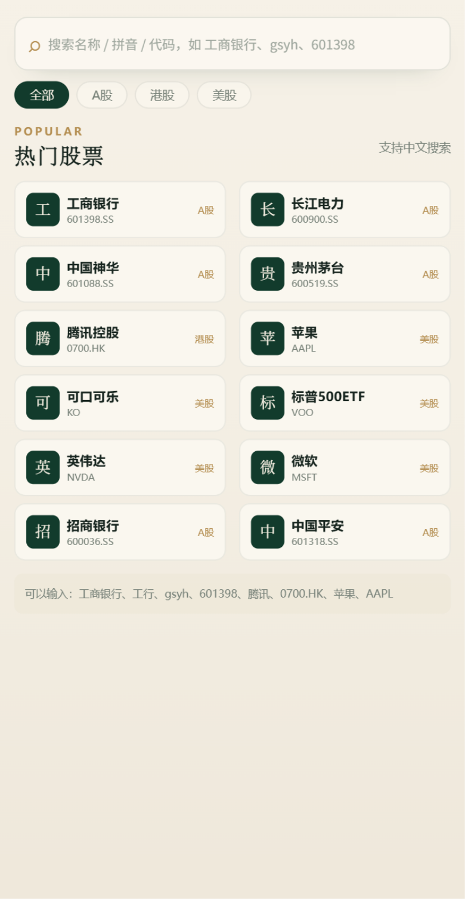
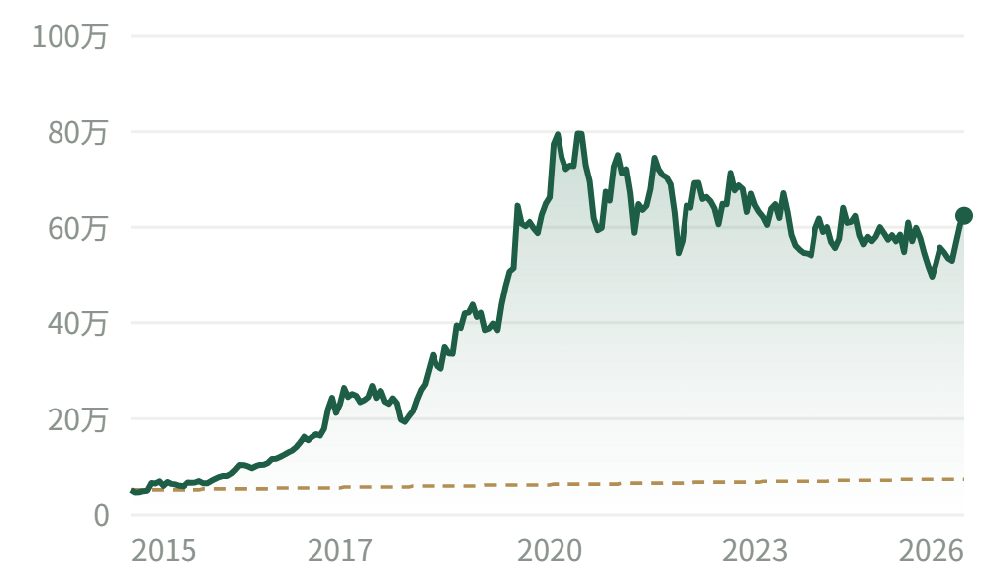

# 息壤 · 股票分红计算器

> 股息再投资历史回测 · 看看分红如何变成更多股份。

一个面向长期收息投资者的**股息再投资历史回测计算器**：选择股票、历史交易日和投入方式，看看如果每次分红都继续买入，到今天账户里会有多少资产。

同时提供 **Web 版** 和 **微信小程序版**。


## 功能

- **中文搜索股票**：支持名称、拼音全拼、拼音首字母、代码和常用别名，例如 `工商`、`工行`、`gsyh`、`601398`、`腾讯`、`0700.HK`、`苹果`、`AAPL`。
- **自定义股票**：A 股、港股、美股，也可以输入 ETF、指数等 Yahoo Finance 支持的代码。
- **只在交易日买入**：开始日必须是真实交易日；选到周末/节假日会提示并给出“使用下一交易日”按钮，不会静默成交。
- **月定投 / 年定投 / 一次性**：定投遇非交易日可选择**顺延到下一交易日**或**跳过本期**。
- **分红再投资**：默认把每次税后分红按除息日收盘价自动买入；也可切换为现金分红做对比。
- **A 股差别化红利税**：按每笔买入份额的持有期分档计税（≤1 个月 20%、1 个月–1 年 10%、>1 年 0%）；美/港股可设置固定预扣税率。
- **送转股处理**：A 股 10 送/转 X 股按实际比例增加持股，并在逐年明细中列出。
- **完整指标**：期末总资产、累计投入、税前/税后分红、红利税、总收益、XIRR、持股数、股息回收率、近 12 个月股息率。
- **逐年分红明细**：点击年份展开当年每次分红的除息日、每股派息、税前/税后金额、实际税率、再投价格与新增份额。
- **可视化**：Web 版使用 ECharts；小程序版使用原生 Canvas 2D 绘制资产曲线和年度分红柱状图。
- **可分享**：Web 版参数同步 URL；小程序支持微信分享。

## 快速开始（Web）

要求 Node.js 20 及以上。

```bash
cd dividend-compounder
npm install
npm start
```

打开 **http://127.0.0.1:3210**。

指定端口：

```powershell
$env:PORT=8080; npm start
```

运行测试（22 个用例）：

```bash
npm test
```

## 微信小程序

小程序代码在 `miniprogram/`，使用原生 WXML/WXSS/JS，不依赖第三方组件库。





### 1. 启动后端

```powershell
cd "D:\DeepSeek自建工具\dividend-compounder"
npm start
```

### 2. 导入微信开发者工具

- 打开微信开发者工具，选择“导入项目”。
- 项目目录选择：
  - 仓库根目录 `dividend-compounder`（已配置 `miniprogramRoot`），或
  - `dividend-compounder/miniprogram`。
- AppID 已配置为测试号；正式发布前把 `project.config.json` 和 `miniprogram/project.config.json` 里的 `appid` 换成你的小程序 AppID。
- 在“详情 → 本地设置”里勾选 **不校验合法域名、web-view（业务域名）、TLS 版本以及 HTTPS 证书**（仅本地开发）。

### 3. API 地址

编辑 `miniprogram/config.js`：

```js
module.exports = {
  apiBase: 'http://127.0.0.1:3210',
};
```

- 开发者工具模拟器可直接用 `127.0.0.1`。
- **真机调试**：把 `apiBase` 改成电脑局域网 IP，例如 `http://192.168.1.20:3210`，并用 `HOST=0.0.0.0` 启动后端：

```powershell
$env:HOST='0.0.0.0'; npm start
```

- **正式发布**：后端必须部署到 HTTPS 域名，并在微信公众平台配置 `request` 合法域名；`apiBase` 改成该域名。完整清单见 [发布清单](docs/publish-checklist.md)。

### 4. 小程序功能

- 首页：中文搜索入口、股票卡、日期选择、定投方式、金额、分红再投资、红利税、测算结果。
- 搜索页：中文名/拼音/首字母/代码搜索，A股/港股/美股筛选，热门股票。
- 结果页：期末资产、累计投入/分红、XIRR、资产曲线、年度分红柱状图、逐年分红再投资明细。
- 关于页：计算口径、数据来源、隐私说明与免责声明。

## 股票搜索

搜索索引由 `scripts/build-stock-index.js` 生成到 `data/stock-index.json`：

- A 股：东方财富股票列表，约 5,600 只，含中文名、拼音全拼、拼音首字母、交易所。
- 港股/美股：内置常用中文名称与别名（腾讯、阿里、美团、苹果、微软、英伟达、可口可乐等）。
- 搜索接口：`GET /api/search?q=工商&market=CN&limit=20`。
- 热门接口：`GET /api/hot`。

重新生成索引（需要 `pinyin-pro`，已列入 devDependencies）：

```bash
npm run index
```

## 数据来源与口径

### A 股

- 价格：**东方财富不复权日线收盘价**。
- 分红：东方财富 `RPT_SHAREBONUS_DET` 中的实际每股派息（`10 派 X 元` → `X / 10`）。
- 送转：按 `BONUS_IT_RATIO + BONUS_RATIO` 计算股数倍数；分红先按送转前持股计算，再做送转。
- 若东方财富不可用，会回退到 Yahoo Finance，并在页面标记“备用数据”。

### 美股 / 港股

- 价格与分红来自 **Yahoo Finance**，使用拆股复权价和拆股调整后的每股分红。
- 持股数为拆股调整后的当前口径。
- 常用港股/美股会使用搜索索引中的中文名称展示。

### 示例数据

`data/seed/` 内置了 7 只示例股票，**离线也可直接体验**：

| 代码 | 名称 | 类型 |
| --- | --- | --- |
| `601398.SS` | 工商银行 | 高股息银行 |
| `600900.SS` | 长江电力 | 水电现金牛 |
| `601088.SS` | 中国神华 | 煤炭高息 |
| `600519.SS` | 贵州茅台 | 消费龙头 |
| `KO` | 可口可乐 | 股息贵族 |
| `AAPL` | 苹果 | 科技成长 |
| `VOO` | 标普 500 ETF | 宽基指数 |

重新抓取示例数据：

```bash
npm run seed -- 601398.SS 600519.SS
```

## 计算规则

1. **开始日**：必须是该股票有行情的交易日。一次性投入在开始日收盘买入。
2. **定投**：从开始日（含）起，每个自然月/年的同一日执行；遇非交易日按高级设定“顺延”或“跳过”，按下一交易日收盘价成交。
3. **分红顺序**：每个交易日先按**送转前持股**计算分红，再处理送转，最后做分红再投资和当期定投。
4. **红利税**：
   - A 股：按每个买入批次的持有天数在除息日估算税率，加权得到实际税率；分红再投资形成的新份额从除息日起算持有期。
   - 美/港股：按固定税率扣除（默认 0%，可在高级设定中调整）。
   - A 股实际个税在卖出时结算，本工具按持有期在分红时估算，因此与券商对账单可能存在时间性差异。
5. **收益**：期末资产 = 持股数 × 最新收盘价 + 未再投资的现金分红；总收益 = 期末资产 − 累计投入。
6. **年化收益**：XIRR（资金加权内部收益率），把每次投入和期末资产视为现金流求解。
7. **未计入**：佣金、印花税、交易滑点、汇率波动、现金利息、送股/转增本身可能产生的税负、配股/增发等公司行动。支持碎股。

## 目录结构

```
dividend-compounder/
├─ server.js                    # 零依赖 Node HTTP 服务 + API + 静态文件
├─ lib/
│  ├─ data.js                   # 东方财富 / Yahoo 抓取、缓存、种子回退
│  └─ search.js                 # 中文 / 拼音 / 代码搜索
├─ public/                      # Web 版
│  ├─ index.html
│  ├─ css/style.css
│  ├─ js/app.js                 # 交互、搜索、ECharts
│  ├─ js/simulate.js            # 纯函数模拟引擎（ESM）
│  └─ vendor/echarts.min.js
├─ miniprogram/                 # 微信小程序
│  ├─ app.js / app.json / app.wxss
│  ├─ config.js                 # API 地址
│  ├─ utils/
│  │  ├─ api.js
│  │  ├─ format.js
│  │  └─ simulate.js            # 由 public/js/simulate.js 生成（CommonJS）
│  └─ pages/
│     ├─ index/                 # 测算首页
│     └─ search/                # 中文搜索
├─ scripts/
│  ├─ fetch-seed.js             # 抓取示例数据
│  ├─ build-stock-index.js      # 生成中文搜索索引
│  └─ build-miniprogram-engine.js
├─ data/
│  ├─ seed/                     # 7 只示例股票历史数据
│  └─ stock-index.json          # 5,600+ 股票搜索索引
├─ test/                        # 22 个单元测试
├─ docs/preview.png
└─ project.config.json          # 微信开发者工具项目配置（根目录导入用）
```

## 修改小程序引擎

小程序不能直接加载 Web 的 ESM 引擎，因此由脚本生成 CommonJS 版本：

```bash
npm run mp:engine
```

源文件是 `public/js/simulate.js`，生成目标是 `miniprogram/utils/simulate.js`。

## 已知限制

- 分红再投资时点使用**除息日收盘价**；实际现金分红通常在派息日到账，二者会带来差异。
- A 股红利税按分红时持有期估算，实际在卖出时结算；长期持有到卖出时可能免税。
- 送股/转增本身未单独计税；配股、增发、缩股等未建模。
- 数据源可能限流或调整字段；A 股优先东方财富，失败时回退 Yahoo 并标记。
- 小程序正式上线需要 HTTPS 域名、已备案后端和微信后台合法域名配置。
- 历史回测不代表未来收益，本工具不构成投资建议。

## License

仅用于个人学习与研究。
